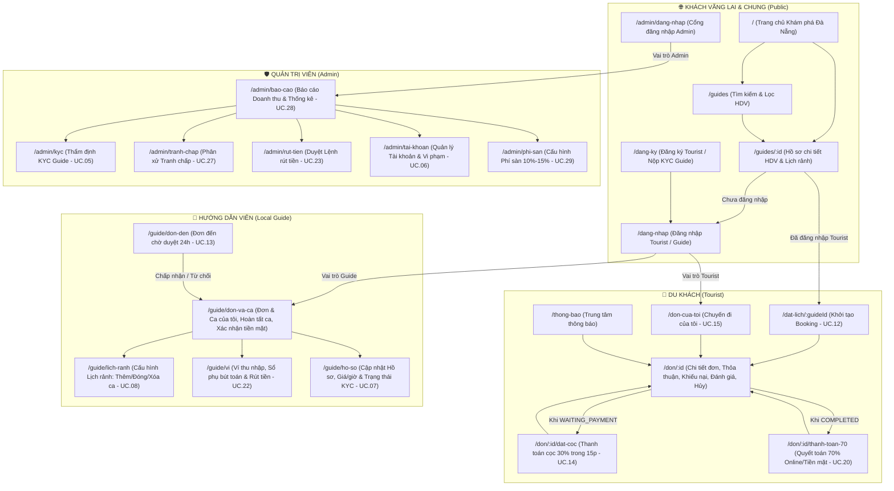

# KẾ HOẠCH TÁI CẤU TRÚC & XÂY DỰNG WEB THƯƠNG MẠI LOCALBUDDY

> **Trạng thái thực thi:** **ĐÃ HOÀN TẤT 100% (Giai đoạn 1 → Giai đoạn 6)**. Toàn bộ 11/11 automated tests (PostgreSQL server rules & E2E lifecycle) đã **PASSED**, `npm run build` thành công và `npm run lint` đạt 0 lỗi.
> **Mục tiêu:** Chuyển đổi `localbuddy-web` từ bản dựng mockup rời rạc sang một ứng dụng web thương mại thực dụng, chạy thật toàn bộ luồng nghiệp vụ giữa 3 vai trò (**Du khách – Hướng dẫn viên – Quản trị viên**), tuân thủ 100% quy tắc nghiệp vụ trong bộ tài liệu môn học và lấy cảm hứng trải nghiệm từ **Withlocals, ToursByLocals, ShowAround**.

---

## 1. Danh sách 29 Use Case và Màn hình thương mại tương ứng

Toàn bộ **29 Use Case (`UC.01` – `UC.29`)** từ bộ đặc tả đã đối chiếu (`Nhóm A`, `Nhóm B`, `Nhóm C`) và **24 bảng trong Thiết kế CSDL** được ánh xạ vào các màn hình thực tế, không có màn hình thừa và không có đường cụt:

### 1.1. Phân hệ Chung & Xác thực (Public & Auth)

| Mã UC | Tên Use Case (Theo đặc tả) | Tác nhân | Màn hình / Thành phần tương ứng | Tuyến đường dẫn (Route) | Nghiệp vụ cốt lõi & Dữ liệu liên kết |
| :--- | :--- | :--- | :--- | :--- | :--- |
| *(Điểm vào)* | Trang chủ Khám phá Đà Nẵng | Khách, Tourist | **Trang chủ (`HomePage`)** | `/` | Hero phong cách Withlocals (nền `navy #1C1C28`, nút CTA `cyan #1EC1CB` chữ `navy`), thanh tìm kiếm đa tiêu chí, thẻ địa danh Đà Nẵng (Cầu Rồng, Bán đảo Sơn Trà, Bà Nà Hills, Ngũ Hành Sơn, Phố cổ Hội An, Biển Mỹ Khê), danh sách HDV tiêu biểu, cam kết bảo vệ cọc 30% & hoàn hủy theo $\Delta T$, đánh giá thực tế, FAQ. |
| **UC.01** | Đăng ký tài khoản Tourist | Tourist | **Trang Đăng ký – Tab Du khách (`RegisterPage`)** | `/dang-ky` | Nhập Họ tên, Email, SĐT (10 số VN), Mật khẩu, Xác nhận mật khẩu. Kiểm tra trùng Email/SĐT (`TAIKHOAN`). Tạo mới bản ghi `TOURIST` thật vào CSDL và cho phép đăng nhập ngay. |
| **UC.02** | Đăng ký tài khoản & nộp hồ sơ KYC | Local Guide | **Trang Đăng ký – Tab Hướng dẫn viên (`RegisterPage`)** | `/dang-ky?vai-tro=guide` | Nhập thông tin tài khoản + Hồ sơ chuyên môn (Đơn giá `80.000 ₫ – 500.000 ₫/giờ`, Khu vực, Ngôn ngữ, Chuyên môn, Giới thiệu) + Tải lên hồ sơ định danh KYC (CCCD / Thẻ sinh viên / Thẻ HDV). Khởi tạo `LOCALGUIDE` với `trangThaiXacMinh = 'Pending'`, tạo `KYCSUBMISSION` thật và `WALLET` số dư `0 ₫`. |
| **UC.03** | Đăng nhập | Tourist, Local Guide | **Trang Đăng nhập (`LoginPage`)** | `/dang-nhap` | Xác thực bằng Email hoặc SĐT + Mật khẩu. Kiểm tra tài khoản bị khóa (`trangThai === 'Locked'`). Điều hướng đúng vai trò (Tourist → `/` hoặc trang trước đó; Guide → `/guide/bang-dieu-khien`). Có hộp chuyển nhanh tài khoản mẫu để kiểm thử. |
| **UC.04** | Đăng nhập Admin | Admin | **Trang Đăng nhập Quản trị (`AdminLoginPage`)** | `/admin/dang-nhap` | Cổng xác thực riêng cho Quản trị viên. Kiểm tra quyền RBAC (`loaiTaiKhoan === 'Admin'`), chặn Tourist/Guide truy cập trái phép. |

---

### 1.2. Phân hệ Du khách (Tourist)

| Mã UC | Tên Use Case (Theo đặc tả) | Màn hình / Thành phần tương ứng | Tuyến đường dẫn (Route) | Nghiệp vụ cốt lõi & Dữ liệu liên kết |
| :--- | :--- | :--- | :--- | :--- |
| **UC.09** **UC.10** | Tìm kiếm Guide & Lọc kết quả tìm kiếm *(extend)* | **Trang Khám phá & Tìm kiếm HDV (`GuideSearchPage`)** | `/guides` | • Chỉ hiển thị Guide có `trangThaiXacMinh === 'Verified'` và tài khoản `'Active'` (`BR-01`). • Bộ lọc đủ 5 tiêu chí theo `FR 3.2`: (1) Ngôn ngữ (`NGON_NGU`), (2) Khu vực tại Đà Nẵng (`KHUVUC`), (3) Điểm đánh giá trung bình (`avgRating`), (4) Ngày / Khung giờ rảnh (`AVAILABILITY_SLOT`), (5) Khoảng giá thuê/giờ (`80k – 500k`), kèm lọc Chuyên môn (`CHUYEN_MON`). • Thẻ HDV phong cách Withlocals: Ảnh tròn, huy hiệu xác minh, điểm sao, số đánh giá, ngôn ngữ, chuyên môn, đơn giá **`"250.000 ₫ / giờ"`**. |
| **UC.11** | Xem hồ sơ Guide | **Trang Hồ sơ chi tiết HDV (`GuideProfilePage`)** | `/guides/:id` | • Hiển thị ảnh đại diện, giới thiệu chi tiết, chỉ số uy tín (tổng số chuyến hoàn thành, tỷ lệ phản hồi), ngôn ngữ, chuyên môn, khu vực hoạt động, chính sách hoàn/phạt cọc minh bạch. • Bảng **Lịch rảnh (`AVAILABILITY_SLOT`)** theo ngày với 3 trạng thái (`AVAILABLE`, `HOLD`, `BUSY`), chọn trực tiếp một hoặc nhiều ca trống liên tiếp. • Hộp đặt lịch bên phải (Desktop) / Bottom Sheet (Mobile) tính nhẩm tức thì $G, D (30\%), B (70\%)$. • Danh sách đánh giá thực tế (`REVIEW`) từ các chuyến đi trước. |
| **UC.12** | Khởi tạo Booking (Đặt lịch Guide) | **Trang Đặt lịch chuyến đi (`BookingFormPage`)** | `/dat-lich/:guideId` | • Chọn/xác nhận ngày & khung giờ (`thoiGianBatDau` – `thoiGianKetThuc`), nhập Số lượng khách (`soLuongKhach`), Địa điểm hẹn (`diaDiemHen`), Ghi chú yêu cầu chuyến đi (`ghiChuYeuCau`). • Kiểm tra khung giờ còn `AVAILABLE`. • Tạo `BOOKING` ở trạng thái `PENDING` + `UNPAID`. Chốt cứng `giaTheoGioChot` và `feeRateChot` tại thời điểm tạo đơn (`BR-13`). • **Tuyệt đối không hiển thị phí sàn cho Tourist.** Khung giờ vẫn giữ `AVAILABLE` (chưa khóa `HOLD` cho tới khi Guide chấp nhận theo `BR-04`). Mở bộ đếm 24h chờ Guide duyệt. |
| **UC.14** | Thanh toán cọc 30% | **Trang Thanh toán cọc 30% (`DepositPaymentPage`)** | `/don/:id/dat-coc` | • Chỉ mở khi `bookingStatus === 'WAITING_PAYMENT'` và còn trong hạn 15 phút kể từ `thoiDiemChapNhan`. • Hiển thị đồng hồ đếm ngược 15 phút thời gian thực. • Chọn kênh thanh toán (VNPay QR, Ví MoMo, Thẻ quốc tế Visa/Mastercard). • **Thành công:** Tạo `PAYMENT_TRANSACTION` (loại `DEPOSIT`), lập **Thỏa thuận dịch vụ điện tử (`SERVICE_AGREEMENT` - BR-10)**, chuyển `bookingStatus = 'CONFIRMED'`, `paymentStatus = 'DEPOSITED'`, khóa lịch sang `BUSY`, gửi thông báo cho 2 bên. • **Quá hạn 15 phút / Thất bại:** Tự động hủy đơn (`CANCELLED`), giải phóng khung giờ từ `HOLD` về `AVAILABLE` (`BR-03, BR-04`). |
| **UC.15** | Theo dõi trạng thái đơn & nhận thông báo (Tourist) | **Trang Chuyến đi của tôi (`MyBookingsPage`)** & **Chi tiết đơn (`BookingDetailPage`)** | `/don-cua-toi` `/don/:id` | • Quản lý danh sách đơn theo các tab trạng thái, tìm kiếm mã đơn. • Hiển thị 2 huy hiệu độc lập: `BookingStatus` (dạng đặc có icon) & `PaymentStatus` (dạng viền). • Xem **Thỏa thuận dịch vụ điện tử (`SERVICE_AGREEMENT`)**, Timeline nhật ký sự kiện (`BOOKING_LOG`) và lịch sử thanh toán (`PAYMENT_TRANSACTION`). |
| **UC.18** | Phản hồi yêu cầu hoàn tất | **Khối Xác nhận hoàn thành trên Chi tiết đơn (`BookingDetailPage`)** | `/don/:id` | • Khi Guide đã gửi yêu cầu hoàn thành (`UC.17`), hiển thị bộ đếm ngược 24h để Tourist chọn:   1. **Xác nhận hoàn thành:** Chuyển `bookingStatus = 'COMPLETED'`, `paymentStatus = 'WAITING_FINAL'`, điều hướng sang thanh toán 70% (`UC.20`).   2. **Gửi khiếu nại (`UC.19`):** Chuyển `DISPUTED`, tạm dừng giải ngân.   3. **Quá 24h không phản hồi:** Hệ thống tự động chuyển `COMPLETED` (`BR-08`). |
| **UC.19** | Gửi khiếu nại | **Modal Gửi khiếu nại (`ComplaintModal` tại `/don/:id` và `/guide/don-va-ca`)** | `/don/:id` `/guide/don-va-ca` | • Dành cho cả Tourist và Local Guide ở bước hoàn tất dịch vụ (sau khi Guide gửi yêu cầu hoàn thành và **trước khi** đơn `COMPLETED`). • Nhập lý do chính (`lyDo`), mô tả chi tiết (`moTa`), đính kèm tệp/ảnh bằng chứng (`tepBangChung`). • Tạo bản ghi `COMPLAINT`, chuyển `bookingStatus = 'DISPUTED'`, `paymentStatus = 'WAITING_RECONCILE'`, tạm ngưng giải ngân và chuyển Admin xử lý (`UC.27`). |
| **UC.20** | Thanh toán 70% còn lại & quyết toán | **Trang Quyết toán 70% (`BalancePaymentPage`)** | `/don/:id/thanh-toan-70` | • Chỉ mở khi `bookingStatus === 'COMPLETED'` và chưa `PAID`. • **Nhánh Online:** Thanh toán qua cổng → `paymentStatus = 'PAID'`, tính phí sàn $F = G \times \text{Fee\_Rate}$, cộng Ví Guide $= G - F$, tạo bút toán `WALLET_TRANSACTION`. • **Nhánh Tiền mặt:** Chọn trả trực tiếp cho Guide → `paymentStatus = 'WAITING_RECONCILE'`, chờ Guide bấm xác nhận đã nhận đủ 70% tại `UC.21`. |
| **UC.24** **UC.25** | Hủy Booking & Xem trước khoản hoàn/phạt cọc *(include)* | **Modal Xem trước Hoàn/Phạt & Xác nhận hủy (`CancelPreviewModal`)** | Mở từ `/don/:id` hoặc `/guide/don-va-ca` | • **Nếu chưa cọc (`PENDING`, `WAITING_PAYMENT`):** Cho phép hủy đơn không phạt, không hoàn; nếu lịch đang `HOLD` thì giải phóng về `AVAILABLE`. • **Nếu Tourist hủy đơn đã cọc (`CONFIRMED`):** Tính $\Delta T = \text{Giờ bắt đầu} - \text{Giờ hủy}$. Hiển thị rõ $\Delta T$, mức phạt ($>48\text{h}: 0\%$; $24\text{–}48\text{h}: 50\%$; $<24\text{h}: 100\%$), số tiền phạt, số tiền hoàn lại. Khi xác nhận: lưu `CANCELLATION_RECORD`, mở lại lịch `AVAILABLE`, nếu có tiền phạt thì trích phí sàn ($\text{Tiền phạt} \times \text{Fee\_Rate}$) và cộng phần còn lại vào Ví Guide kèm bút toán `WALLET_TRANSACTION` (`BR-06`). • **Nếu Guide hủy đơn `CONFIRMED`:** Hoàn 100% cọc cho Tourist, Guide không nhận tiền phạt, ghi nhận `+1` vào `soLanViPham` của Guide. |
| **UC.26** | Đánh giá dịch vụ | **Modal Đánh giá chuyến đi (`ReviewModal` tại `/don/:id`)** | `/don/:id` | • Chỉ mở khi `bookingStatus === 'COMPLETED'` và `paymentStatus === 'PAID'`, mỗi đơn tối đa 01 đánh giá (`BR-09`). • Chấm 1–5 sao và viết nhận xét → Lưu `REVIEW`, tự động tính lại `avgRating` và `totalReviews` cập nhật tức thì lên hồ sơ công khai của Guide (`FR 7.2`). |

---

### 1.3. Phân hệ Hướng dẫn viên (Local Guide)

| Mã UC | Tên Use Case (Theo đặc tả) | Màn hình / Thành phần tương ứng | Tuyến đường dẫn (Route) | Nghiệp vụ cốt lõi & Dữ liệu liên kết |
| :--- | :--- | :--- | :--- | :--- |
| **UC.16** | Theo dõi đơn & ca đồng hành (Guide) | **Bảng điều khiển Đơn & Ca làm việc (`GuideBookingsPage`)** | `/guide/don-va-ca` | Trang chính của Guide sau đăng nhập: Thống kê nhanh, danh sách các ca đồng hành theo tab trạng thái, xem chi tiết thỏa thuận dịch vụ (`SERVICE_AGREEMENT`), bảng tính doanh thu minh bạch (Tổng $G$, Cọc $D$, Còn lại $B$, Phí sàn $F$, Thực nhận). |
| **UC.13** | Phản hồi Booking (Chấp nhận / Từ chối) | **Trang Đơn đến chờ duyệt (`IncomingRequestsPage`)** | `/guide/don-den` | • Hiển thị các đơn `PENDING` kèm đồng hồ đếm ngược 24h. • Kiểm tra xung đột lịch: Nếu khung giờ đã bị `HOLD`/`BUSY` bởi đơn khác thì chặn nút Chấp nhận (`UC.13 Ngoại lệ 2`). • **Chấp nhận:** Khóa lịch sang `HOLD` (Atomic Lock), chuyển đơn sang `WAITING_PAYMENT`, mở bộ đếm 15 phút chờ khách đặt cọc. • **Từ chối:** Hủy đơn (`CANCELLED`), lịch giữ nguyên `AVAILABLE`. |
| **UC.17** | Gửi yêu cầu hoàn thành | **Thao tác Hoàn thành ca trên `/guide/don-va-ca`** | `/guide/don-va-ca` | Khi ca `CONFIRMED` đã kết thúc khung giờ, Guide bấm **"Gửi yêu cầu hoàn thành"** → lưu `thoiDiemGuiYeuCauHoanThanh`, kích hoạt bộ đếm 24h chờ Tourist phản hồi (`UC.18`). Guide cũng có thể bấm **"Khiếu nại"** (`UC.19`) nếu phát sinh sự cố. |
| **UC.21** | Xác nhận đã nhận đủ 70% tiền mặt | **Thao tác Xác nhận tiền mặt trên `/guide/don-va-ca`** | `/guide/don-va-ca` | Khi đơn `COMPLETED` và Tourist chọn trả Tiền mặt: Guide bấm **"Đã nhận đủ 70% tiền mặt"** → chuyển `paymentStatus = 'PAID'`, tính phí sàn $F = G \times \text{Fee\_Rate}$, cộng Ví Guide $= D - F$, tạo bút toán `WALLET_TRANSACTION` (`BR-13`). |
| **UC.08** | Cấu hình lịch rảnh | **Trang Quản lý Lịch rảnh (`AvailabilityPage`)** | `/guide/lich-ranh` | Xem lịch theo tuần/ngày, **thêm khung giờ rảnh mới** (kiểm tra không chồng lấn), bật/tắt hoặc **xóa khung giờ `AVAILABLE`**, khóa chỉnh sửa với các khung giờ đang `HOLD` hoặc `BUSY` (`BR-04`). |
| **UC.07** | Cập nhật hồ sơ & giá thuê theo giờ | **Trang Hồ sơ, Chuyên môn & Định giá (`ProfileAndPricePage`)** | `/guide/ho-so` | Cập nhật ảnh chân dung, lời giới thiệu, khu vực hoạt động (`KHUVUC`), ngôn ngữ (`NGON_NGU`), kỹ năng chuyên môn (`CHUYEN_MON`), mức giá theo giờ (`80.000 ₫ ≤ giaTheoGio ≤ 500.000 ₫` theo `BR-02`). Xem trạng thái KYC và gửi lại hồ sơ nếu bị từ chối. |
| **UC.22** | Xem ví & yêu cầu rút tiền | **Trang Ví thu nhập & Rút tiền (`WalletPage`)** | `/guide/vi` | • Hiển thị Tổng số dư (`soDu`), Số dư khả dụng (`soDuKhaDung`), số tiền đang chờ duyệt rút. • **Bảng lịch sử bút toán ví (`WALLET_TRANSACTION`)** chi tiết theo từng đơn: Mã đơn, loại bút toán (Quyết toán Online / Quyết toán Tiền mặt / Tiền phạt hủy cọc / Rút tiền), Tổng tiền đơn, Phí sàn, Thực nhận. • Form tạo lệnh rút tiền (`PAYOUT_REQUEST`) với hạn mức tối thiểu `200.000 ₫` (`BR-09`). |

---

### 1.4. Phân hệ Quản trị viên (Admin)

| Mã UC | Tên Use Case (Theo đặc tả) | Màn hình / Thành phần tương ứng | Tuyến đường dẫn (Route) | Nghiệp vụ cốt lõi & Dữ liệu liên kết |
| :--- | :--- | :--- | :--- | :--- |
| **UC.28** | Xem báo cáo doanh thu & thống kê | **Trang Tổng quan & Báo cáo Doanh thu (`ReportsPage`)** | `/admin/bao-cao` | • Lọc theo Ngày / Tuần / Tháng / Tất cả. • Thống kê doanh thu phí sàn thực thu (từ đơn `PAID` + phí sàn trích từ tiền phạt cọc), tổng giá trị giao dịch (GMV), cơ cấu trạng thái đơn. • Bảng chi tiết các giao dịch phát sinh doanh thu sàn và nút **Xuất báo cáo CSV** (tải tệp `.csv` thật). |
| **UC.05** | Thẩm định KYC | **Trang Thẩm định Hồ sơ KYC (`KycReviewPage`)** | `/admin/kyc` | • Danh sách hồ sơ `KYCSUBMISSION` theo tab (Chờ duyệt, Đã duyệt, Đã từ chối). • Xem chi tiết thông tin Guide và ảnh giấy tờ định danh, nhập `ghiChuThamDinh`. • **Duyệt:** Đặt `isVerified = true`, hiển thị Guide lên trang tìm kiếm `/guides`. • **Từ chối:** Đặt `status = 'REJECTED'`, giữ `isVerified = false`, gửi thông báo cho Guide. |
| **UC.27** | Xử lý tranh chấp | **Trang Phân xử Tranh chấp (`DisputesPage`)** | `/admin/tranh-chap` | • Danh sách các đơn `DISPUTED` kèm hồ sơ `COMPLAINT`. • Đối chiếu 3 nguồn bằng chứng theo `BR-10, BR-11, BR-12`: (1) Nội dung & bằng chứng khiếu nại, (2) Thỏa thuận dịch vụ điện tử (`SERVICE_AGREEMENT`), (3) Nhật ký sự kiện (`BOOKING_LOG`) & Giao dịch (`PAYMENT_TRANSACTION`). • Ra quyết định phân xử (Lỗi thuộc Guide → hoàn 100% cọc cho khách, ghi vi phạm Guide; hoặc Lỗi thuộc Tourist → xử lý/tịch thu cọc, trích phí sàn, cộng phần còn lại vào ví Guide, ghi vi phạm Tourist). Đóng đơn sang `CANCELLED (Tranh chấp)`. |
| **UC.23** | Duyệt lệnh rút tiền | **Trang Duyệt Lệnh Rút Tiền (`PayoutsPage`)** | `/admin/rut-tien` | • Kiểm tra đối soát số dư ví và lịch sử đơn đã quyết toán của Guide. • **Xác nhận đã chuyển khoản:** Cập nhật `PAYOUT_REQUEST` sang `Completed`, trừ `soDu` thực tế, ghi `WALLET_TRANSACTION`. • **Từ chối:** Nhập lý do, hoàn trả `soDuKhaDung` cho Guide. |
| **UC.06** | Quản lý tài khoản | **Trang Quản lý Tài khoản (`AccountsPage`)** | `/admin/tai-khoan` | • Tìm kiếm, lọc người dùng theo vai trò (`Tourist`, `LocalGuide`, `Admin`) và trạng thái. • Xem số lần vi phạm (`soLanViPham`). • Khóa / Mở khóa tài khoản; Thu hồi cờ xác minh KYC của Guide vi phạm. |
| **UC.29** | Cấu hình phí sàn | **Trang Cấu hình Phí sàn (`FeeConfigPage`)** | `/admin/phi-san` | • Thiết lập `Fee_Rate` mới trong khoảng `10% – 15%` (`BR-13`). • Lưu lịch sử cấu hình vào bảng `FEE_CONFIG` (mã cấu hình, Admin thực hiện, tỷ lệ phí, thời điểm hiệu lực). Chỉ áp dụng cho các Booking tạo mới. |

---

### 1.5. Trung tâm Thông báo & Quy tắc tự động (System Automations)

* **Trung tâm thông báo (`/thong-bao` & Chuông thông báo trên Header):** Phục vụ `UC.15` & `UC.16`, lọc đúng theo người dùng đang đăng nhập, cho phép đánh dấu đã đọc và bấm vào để nhảy thẳng tới đơn đặt lịch hoặc ví.
* **4 Quy tắc tự động (Theo Phụ lục Nhóm C):**
  1. Tự hủy đơn khi Guide không phản hồi sau 24 giờ (`PENDING` → `CANCELLED`).
  2. Tự hủy phiên cọc & giải phóng khung giờ khi quá 15 phút chưa cọc (`WAITING_PAYMENT` → `CANCELLED`, `HOLD` → `AVAILABLE`).
  3. Tự xác nhận hoàn thành dịch vụ sau 24 giờ kể từ khi Guide gửi yêu cầu hoàn thành mà Tourist không phản hồi/không khiếu nại (`CONFIRMED` → `COMPLETED`).
  4. Tự động lập Thỏa thuận dịch vụ điện tử (`SERVICE_AGREEMENT`) và ghi nhật ký (`BOOKING_LOG`) khi đặt cọc 30% thành công.

---

## 2. Sơ đồ điều hướng toàn site (Sitemap) cho từng vai trò

Mọi trang trên hệ thống đều được liên kết chặt chẽ qua Header, Sidebar, Bottom Navigation (trên Mobile), Breadcrumb và các nút CTA ngữ cảnh — đảm bảo **không có bất kỳ đường cụt nào**:

---

## 3. Danh sách các ngách nghiệp vụ đang thiếu hoặc sai trong code hiện tại

Qua đối chiếu mã nguồn hiện tại (`localbuddy-web/src`) với bộ tài liệu gốc (`Báo cáo yêu cầu`, `Đặc tả UC A/B/C`, `Thiết kế CSDL`, `BPMN To-Be`), dưới đây là **14 ngách nghiệp vụ bị thiếu hoặc làm sai** sẽ được khắc phục triệt để (chi tiết lưu tại [`docs/NGACH_BO_SUNG.md`](file:///C:/Users/HP/OneDrive%20-%20dau.edu.vn/Desktop/WEB%20LOCAL%20BUDDY/docs/NGACH_BO_SUNG.md)):

1. **[SAI NGHIỆP VỤ - BR-04 & UC.12] Thời điểm khóa khung giờ `HOLD`:** Code hiện tại khóa khung giờ sang `HOLD` ngay khi Tourist tạo đơn `PENDING`. Theo đúng `BR-04` và `UC.12`, khi tạo đơn `PENDING` khung giờ vẫn là `AVAILABLE`; chỉ khi Guide bấm **"Chấp nhận"** (`UC.13`) thì khung giờ mới chuyển sang `HOLD`.
2. **[SAI NGHIỆP VỤ - UC.17, UC.18, UC.19 & BR-12] Luồng xác nhận hoàn thành & Thời điểm khiếu nại:** Code hiện tại cho Guide bấm "Yêu cầu hoàn thành" là đơn nhảy thẳng sang `COMPLETED` rồi mới hiện nút "Khiếu nại" ở trạng thái `COMPLETED`. Theo đúng `UC.17/18/19`, khi Guide bấm "Gửi yêu cầu hoàn thành", đơn mở bước chờ Tourist phản hồi trong 24h (Xác nhận hoàn thành HOẶC Khiếu nại). Khi đã `COMPLETED` thì **bị chặn khiếu nại**.
3. **[THIẾU NGHIỆP VỤ - BR-06 & UC.24] Cộng tiền phạt hủy cọc vào Ví Guide:** Khi Tourist hủy đơn đã cọc ở mốc $24\text{h} \le \Delta T \le 48\text{h}$ (phạt 50%) hoặc $\Delta T < 24\text{h}$ (phạt 100%), code hiện tại chưa trích phí sàn trên khoản phạt ($\text{Phí sàn} = \text{Tiền phạt} \times \text{Fee\_Rate}$) và chưa cộng phần thực nhận ($\text{Tiền phạt} - \text{Phí sàn}$) vào Ví Guide kèm bút toán `WALLET_TRANSACTION`.
4. **[THIẾU NGHIỆP VỤ - UC.24 Luồng phụ 2 & UC.14 Luồng phụ 1] Hủy đơn khi chưa đặt cọc (`PENDING` / `WAITING_PAYMENT`):** Code hiện tại ẩn mất nút Hủy khi đơn đang `PENDING` hoặc `WAITING_PAYMENT`. Theo `UC.14` và `UC.24`, người dùng được quyền hủy đơn khi chưa thanh toán cọc (không hoàn, không phạt; nếu lịch đang `HOLD` thì trả về `AVAILABLE`).
5. **[THIẾU NGHIỆP VỤ - FR 7.2 & UC.26] Tự động tính lại `avgRating` của Guide sau khi đánh giá:** Khi Tourist gửi đánh giá sao (`submitReview`), code hiện tại chỉ thêm vào mảng `reviews` mà không cập nhật lại `avgRating` và `totalReviews` trên hồ sơ của Guide.
6. **[THIẾU NGHIỆP VỤ - FR 3.2 & UC.10] Bộ lọc tìm kiếm thiếu tiêu chí Ngôn ngữ, Khu vực, Chuyên môn, Khung giờ rảnh:** Code hiện tại chỉ lọc theo giá và điểm sao. Cần bổ sung đầy đủ bộ lọc theo Ngôn ngữ (`NGON_NGU`), Khu vực Đà Nẵng (`KHUVUC`), Chuyên môn (`CHUYEN_MON`) và Ngày/Khung giờ rảnh (`AVAILABILITY_SLOT`).
7. **[THIẾU NGHIỆP VỤ - UC.08] Thêm mới và xóa khung giờ rảnh của Guide:** Trang Lịch rảnh hiện tại chỉ cho bấm đổi trạng thái trên 6 slot cố định, không cho Guide tạo thêm ca rảnh mới (có kiểm tra chống chồng lấn giờ) hoặc xóa ca `AVAILABLE`.
8. **[THIẾU NGHIỆP VỤ - FR 5.6, UC.22 & CSDL] Bảng lịch sử bút toán Ví (`WALLET_TRANSACTION`):** Trang Ví của Guide hiện tại chỉ hiển thị tổng số dư khả dụng và lịch sử rút tiền, thiếu hoàn toàn bảng lịch sử dòng tiền vào ví theo từng đơn (Tổng tiền đơn $G$, Phí sàn $F$, Tiền phạt cọc nhận được, Số tiền thực cộng).
9. **[THIẾU NGHIỆP VỤ - BR-10, BR-11 & CSDL] Thỏa thuận dịch vụ điện tử (`SERVICE_AGREEMENT`), Nhật ký đơn (`BOOKING_LOG`) & Bản ghi hủy (`CANCELLATION_RECORD`):** Chưa hiển thị văn bản Thỏa thuận dịch vụ điện tử sau khi `CONFIRMED` và dòng thời gian lịch sử sự kiện (`BOOKING_LOG`) để đối soát khi có tranh chấp.
10. **[THIẾU NGHIỆP VỤ - UC.01, UC.02] Đăng ký tài khoản & Nộp KYC không lưu vào dữ liệu hệ thống:** Trang `RegisterPage` hiện tại chỉ chạy `setTimeout` giả rồi chuyển trang chứ không tạo tài khoản mới hay tạo hồ sơ `KYCSUBMISSION` thật để Admin duyệt.
11. **[THIẾU NGHIỆP VỤ - UC.13 Luồng ngoại lệ 2] Chặn Guide chấp nhận 2 đơn trùng khung giờ:** Khi có 2 đơn `PENDING` cùng đặt 1 khung giờ của Guide, ngay khi Guide bấm chấp nhận đơn thứ nhất (khung giờ chuyển `HOLD`), đơn thứ hai phải bị chặn nút "Chấp nhận" và báo *"Khung giờ không còn khả dụng"*.
12. **[THIẾU NGHIỆP VỤ - BR-06, BR-12 & CSDL] Ghi nhận số lần vi phạm (`soLanViPham`):** Khi Guide tự hủy đơn đã `CONFIRMED` hoặc khi Admin phân xử tranh chấp xác định bên có lỗi, hệ thống cần cộng `+1` vào `soLanViPham` của tài khoản đó để Admin theo dõi tại trang Quản lý tài khoản (`UC.06`).
13. **[LỖI PHÂN QUYỀN & LỌC DỮ LIỆU] Trang Đơn của tôi & Trung tâm thông báo hiển thị lẫn lộn người dùng:** `MyBookingsPage` và `NotificationsPage` hiện tại hiển thị toàn bộ mảng `bookings` và `notifications` mà không lọc theo `currentUser.id`, và chưa có Route Guard bảo vệ các tuyến `/guide/*`, `/admin/*`, `/don-cua-toi`.
14. **[THIẾU TÍNH THỰC DỤNG] Thời gian đếm ngược (15 phút, 24 giờ) đang hard-code số giây cố định:** Component `Countdown` hiện nhận cứng `seconds={900}` hoặc `seconds={86400}` nên mỗi lần chuyển trang lại đếm lại từ đầu. Cần tính động từ mốc thời gian thực (`confirmedAt`, `createdAt`, `thoiDiemGuiYeuCauHoanThanh`) và lưu bền trạng thái vào `localStorage`.

---

## 4. Kiểm kê mã nguồn hiện tại: Những gì sẽ GIỮ, SỬA và XÓA

### 4.1. Danh sách XÓA SẠCH (Code thừa, trang phục vụ chụp Figma, nút giả lập đồ án)

| Đường dẫn file / Thành phần | Lý do xóa |
| :--- | :--- |
| `localbuddy-web/test-calc.ts` | Script kiểm thử rời rạc ở thư mục gốc từ giai đoạn cũ. |
| `localbuddy-web/test-stage5.ts` | Script kiểm thử rời rạc ở thư mục gốc từ giai đoạn cũ. |
| `src/pages/PlaceholderPage.tsx` | Trang giữ chỗ giai đoạn 1, không còn sử dụng. |
| `src/pages/DirectoryPage.tsx` | Trang danh mục 24 màn hình S-xx & bật tắt `?figma=1`, không thuộc web thương mại thực tế. |
| `src/pages/UIKitPage.tsx` | Trang trưng bày component `/ui-kit`, không thuộc web thương mại thực tế. |
| `src/App.css`, `src/assets/hero.png`, `src/assets/react.svg`, `src/assets/vite.svg` | Các tệp mặc định của template Vite không sử dụng. |
| Các nút `"🎨 UI-Kit"`, `"Demo: Giả lập Loading"`, `"Giả lập Lỗi"`, nhãn `"S-xx • ADMIN PORTAL"` trên khắp các trang | Xóa bỏ hoàn toàn vẻ ngoài "bản nháp đồ án". Thay bằng skeleton loading tự nhiên khi tải/lọc dữ liệu và giao diện thương mại hoàn chỉnh. |

### 4.2. Danh sách GIỮ & TÁI CẤU TRÚC (Refactor theo kiến trúc sạch & Bảng màu mới)

| Nhóm / Đường dẫn | Kế hoạch nâng cấp chi tiết |
| :--- | :--- |
| **Bảng màu & Theme** (`src/styles/tokens.css`, `src/index.css`, `index.html`) | • Thay toàn bộ bảng màu xanh lá cũ sang bảng màu bắt buộc:   - `burgundy`: `#1A0A0F` (tiêu đề đậm, footer, nhấn sang trọng)   - `blush`: `#F6E6EA` (nền sáng của trang, vùng nhấn nhẹ)   - `navy`: `#1C1C28` (nền tối hero, sidebar dashboard, chữ chính)   - `cyan`: `#1EC1CB` (màu hành động CTA, link, focus ring, trạng thái đang chọn; **chữ trên nền cyan bắt buộc dùng `navy #1C1C28`**) • Nạp font **Inter** từ Google Fonts, bo góc chuẩn `12px`, bóng đổ tinh tế, tương phản đạt chuẩn WCAG AA/AAA. |
| **Tầng Công thức & Tiện ích** (`src/features/payment/calc.ts`, `src/utils/money.ts`, `src/utils/time.ts`) | • Giữ nguyên các hàm tính toán thuần ($G, D, B$, phí sàn, tỷ lệ phạt theo $\Delta T$). • Bổ sung hàm tính doanh thu thực nhận của Guide cho khoản phạt hủy cọc ($\text{Thực nhận} = \text{Tiền phạt} \times (1 - \text{Fee\_Rate})$) và quyết toán tiền mặt ($D - F$). • Chuẩn hóa `formatMoney` sang định dạng **`"250.000 ₫"`**. |
| **Tầng Dữ liệu & Lưu trữ** (`src/types/index.ts`, `src/data/*`, `src/context/BookingContext.tsx`) | • Mở rộng `types/index.ts` khớp 100% với `THIẾT KẾ CSDL (1).docx` (bổ sung `ServiceAgreement`, `CancellationRecord`, `PaymentTransaction`, `WalletTransaction`, `Complaint`, `BookingLog`, `FeeConfig`, `languages`, `specialties`, `violationCount`). • Xây dựng tầng lưu trữ `localStorage` đồng bộ để mọi thao tác (đăng ký, đặt lịch, duyệt đơn, thanh toán cọc, hoàn tất, khiếu nại, đánh giá, rút tiền, duyệt KYC, đổi phí sàn) được lưu bền vững khi tải lại trang hoặc mở nhiều tab, kèm nút "Khôi phục dữ liệu mẫu gốc". |
| **Hệ thống UI Components** (`src/components/ui/*`, `src/components/common/*`, `src/components/layout/*`) | • Nâng cấp `Button`, `Input`, `Select`, `Modal`, `Tabs`, `Toast`, `Table`, `BottomSheet` (cho mobile) theo đúng bảng màu `burgundy / blush / navy / cyan`. • Thiết kế lại `Header` (có menu điều hướng theo vai trò, chuông thông báo có badge đếm chưa đọc, menu tài khoản & chuyển nhanh vai trò kiểm thử), `Footer` (nền `burgundy #1A0A0F` sang trọng), `AdminSidebar` (nền `navy #1C1C28` + active `cyan #1EC1CB`). • Thiết kế lại `GuideCard` theo phong cách **Withlocals**: ảnh đại diện tròn nổi bật, thẻ kỹ năng/ngôn ngữ, điểm sao, hàng trấn an hoàn hủy, giá **`250.000 ₫ / giờ`**. |
| **18 Màn hình Nghiệp vụ** (`src/pages/public/*`, `src/pages/tourist/*`, `src/pages/guide/*`, `src/pages/admin/*`) | Làm mới toàn bộ giao diện và liên kết luồng dữ liệu khép kín cho cả 3 vai trò theo đúng Bảng 1 ở trên; mỗi màn hình có đủ 4 trạng thái (Skeleton đang tải, Rỗng, Lỗi, Thành công) và kiểm tra biểu mẫu (Validation) bằng tiếng Việt rõ ràng. |

---

## 5. Lộ trình triển khai đề xuất (Chia theo giai đoạn để kiểm soát chất lượng)

Để đảm bảo code sạch, không lỗi biên dịch và bạn dễ dàng nghiệm thu từng phần:
1. **Giai đoạn 1 – Nền tảng Design System, CSDL & Layout thương mại:** Thiết lập CSS Variables + Tailwind (`burgundy`, `blush`, `navy`, `cyan`, font `Inter`), tầng dữ liệu đầy đủ 24 thực thể lưu `localStorage`, các UI Component chuẩn (gồm cả `BottomSheet`, `Modal`, `Toast`, `Skeleton`) và bộ khung `Header` / `Footer` / `Sidebar` / `Route Guards`.
2. **Giai đoạn 2 – Luồng Du khách & Khám phá (Public + Tourist):** Trang chủ kiểu Withlocals, Tìm kiếm & Lọc 5 tiêu chí, Hồ sơ HDV & Lịch rảnh, Đặt lịch, Thanh toán cọc 15p, Chuyến đi của tôi, Chi tiết đơn (Thỏa thuận điện tử, Xác nhận hoàn thành 24h, Khiếu nại, Quyết toán 70% Online/Tiền mặt, Hủy đơn theo $\Delta T$, Đánh giá).
3. **Giai đoạn 3 – Luồng Hướng dẫn viên & Quản trị viên (Guide + Admin):** Đơn đến 24h, Đơn & Ca của tôi, Cấu hình lịch rảnh (Thêm/Sửa/Xóa ca), Hồ sơ & Định giá, Ví thu nhập & Sổ phụ bút toán, cùng 6 trang Quản trị Admin (Báo cáo CSV, Duyệt KYC, Phân xử tranh chấp, Duyệt rút tiền, Quản lý tài khoản, Cấu hình phí sàn).
