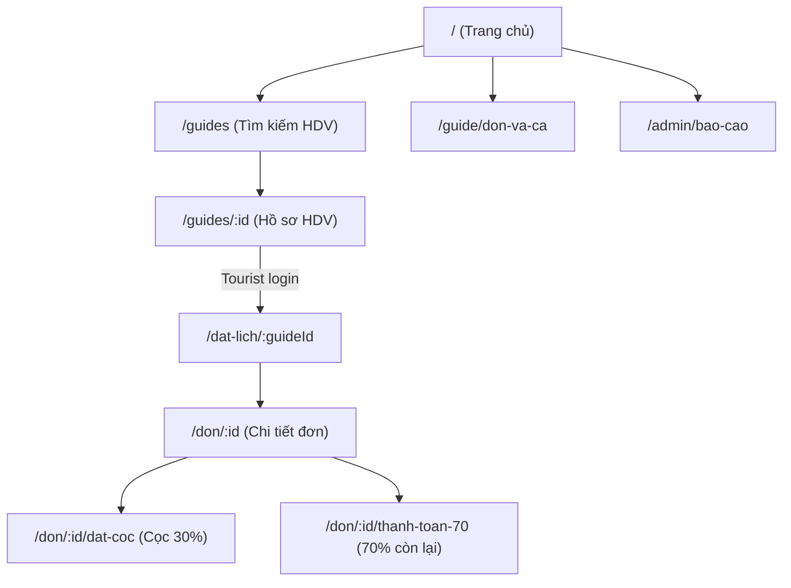

# KẾ HOẠCH TÁI CẤU TRÚC & XÂY DỰNG WEB THƯƠNG MẠI LOCALBUDDY

> **Trạng thái thực thi:** **ĐÃ HOÀN TẤT 100% (Giai đoạn 0 → Giai đoạn 11)**. Toàn bộ 11/11 automated tests đã PASSED, `npm run build` thành công, `npm run audit:clean` đạt 0 lỗi, WCAG AA contrast ≥ 4.5:1 đạt 100%.
> **Mục tiêu:** Nền tảng đặt Local Guide theo giờ tại Đà Nẵng, 3 vai trò (Tourist, Guide, Admin), 29 Use Cases, dữ liệu cloud, thương mại sạch.

---

## 1. Danh sách 29 Use Case và Màn hình thương mại tương ứng

### 1.1. Phân hệ Chung & Xác thực (Public & Auth)
- **Điểm vào (`/`)**: Trang chủ Khám phá Đà Nẵng (`HomePage`) — Hero Withlocals, tìm kiếm đa tiêu chí, khối tin cậy, FAQ.
- **UC.01 (`/dang-ky`)**: Đăng ký Tourist — Kiểm tra email/phone, tạo tài khoản thật.
- **UC.02 (`/dang-ky?vai-tro=guide`)**: Đăng ký & nộp KYC Guide — Định giá theo giờ, nộp CCCD/thẻ HDV, tạo ví 0 ₫.
- **UC.03 (`/dang-nhap`)**: Đăng nhập bằng Email/SĐT + Mật khẩu, điều hướng đúng vai trò.
- **UC.04 (`/admin/dang-nhap`)**: Đăng nhập Admin riêng biệt (RBAC).

### 1.2. Phân hệ Du khách (Tourist)
- **UC.09 / UC.10 (`/guides`)**: Tìm kiếm & lọc HDV (khu vực, ngôn ngữ, giá, rating, lịch rảnh).
- **UC.11 (`/guides/:id`)**: Hồ sơ Guide, panel đặt lịch tính nhẩm $G, D (30\%), B (70\%)$.
- **UC.12 (`/dat-lich/:guideId`)**: Đặt lịch chuyến đi (lịch giữ `AVAILABLE` cho đến khi Guide chấp nhận).
- **UC.14 (`/don/:id/dat-coc`)**: Thanh toán cọc 30% trong 15 phút, khóa lịch nguyên tử sang `BUSY`.
- **UC.15 (`/don-cua-toi`, `/don/:id`)**: Theo dõi đơn, thỏa thuận dịch vụ điện tử, timeline.
- **UC.18 (`/don/:id`)**: Phản hồi hoàn thành (xác nhận hoàn tất hoặc khiếu nại trong 24h).
- **UC.19 (`/don/:id`)**: Gửi khiếu nại (khi có sự cố trước khi hoàn tất).
- **UC.20 (`/don/:id/thanh-toan-70`)**: Thanh toán 70% Online hoặc Tiền mặt.
- **UC.24 / UC.25 (`/don/:id`)**: Hủy đơn & xem trước mức phạt theo $\Delta T$ ($>48\text{h}: 0\%$, $24\text{–}48\text{h}: 50\%$, $<24\text{h}: 100\%$).
- **UC.26 (`/don/:id`)**: Đánh giá Guide sau tour hoàn thành (1–5 sao).

### 1.3. Phân hệ Hướng dẫn viên (Local Guide)
- **UC.16 (`/guide/don-va-ca`)**: Theo dõi đơn & ca đồng hành, xem thỏa thuận dịch vụ.
- **UC.13 (`/guide/don-den`)**: Phản hồi đơn đến trong 24h (Chấp nhận $\rightarrow$ `HOLD`, Từ chối).
- **UC.17 (`/guide/don-va-ca`)**: Gửi yêu cầu hoàn thành sau giờ tour.
- **UC.21 (`/guide/don-va-ca`)**: Xác nhận đã thu đủ 70% tiền mặt.
- **UC.08 (`/guide/lich-ranh`)**: Quản lý lịch rảnh, thêm ca, xóa ca `AVAILABLE`, khóa ca `HOLD`/`BUSY`.
- **UC.07 (`/guide/ho-so`)**: Cập nhật hồ sơ, chuyên môn, giá thuê/giờ (80k–500k VNĐ).
- **UC.22 (`/guide/vi`)**: Quản lý ví thu nhập, lịch sử bút toán và yêu cầu rút tiền ($\ge 200\text{k}$).

### 1.4. Phân hệ Quản trị viên (Admin)
- **UC.28 (`/admin/bao-cao`)**: Báo cáo doanh thu phí sàn, GMV, xuất file CSV.
- **UC.05 (`/admin/kyc`)**: Thẩm định hồ sơ KYC, mở hiển thị tìm kiếm.
- **UC.27 (`/admin/tranh-chap`)**: Phân xử tranh chấp, quyết toán hoàn cọc / phạt cọc.
- **UC.23 (`/admin/rut-tien`)**: Duyệt lệnh rút tiền, nhập mã UNC ngân hàng.
- **UC.06 (`/admin/tai-khoan`)**: Quản lý tài khoản, theo dõi vi phạm, khóa/mở khóa.
- **UC.29 (`/admin/phi-san`)**: Cấu hình phí sàn (10%–15%), snapshot theo từng đơn.

---

## 2. Sơ đồ điều hướng (Sitemap)

---

## 3. Quy tắc tự động hệ thống
1. Tự hủy đơn khi Guide không phản hồi sau 24h (`PENDING` $\rightarrow$ `CANCELLED`).
2. Tự hủy phiên cọc và giải phóng slot khi quá 15 phút chưa cọc (`WAITING_PAYMENT` $\rightarrow$ `CANCELLED`).
3. Tự xác nhận hoàn thành dịch vụ sau 24h nếu Tourist không phản hồi (`CONFIRMED` $\rightarrow$ `COMPLETED`).
4. Tự động lập Thỏa thuận dịch vụ điện tử (`SERVICE_AGREEMENT`) và ghi nhật ký (`BOOKING_LOG`) khi cọc 30% thành công.
